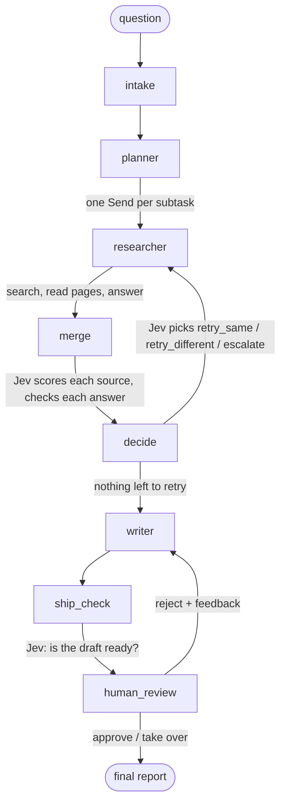

# Multi-agent research assistant

Ask a research question. A planner splits it into subtasks, researchers search the web for
them in parallel, and a draft report is written. Along the way, **Jev** (TypeSafe's typed
decision model) makes the small judgement calls: is this web page any use, did this answer
address its question, should a weak subtask be retried, is the draft ready for a person?
Before anything is delivered the run **pauses for a human** to approve, reject with
feedback, or take over. The whole run is checkpointed, so a pause or a crash survives a
process restart.

Built with LangGraph, to practise two things: `interrupt()` for human-in-the-loop and
checkpointing for durable runs, and to use Jev where its typed answers (no text to parse)
fit better than a chat-model call.

## How a run goes



1. **Plan.** An LLM (Groq by default, Gemini optional) splits the question into 2 to 3
   self-contained subtasks.
2. **Research.** One researcher per subtask runs in parallel (LangGraph `Send`). Each
   searches the web (Tavily), reads the page text, and answers from those pages only (Groq).
   Failures become typed results (`found`, `no_results`, `failed`), never exceptions, so one
   bad search cannot sink the others.
3. **Check (Jev).** `merge` drops sources that are too thin or that Jev scores as not
   useful, then asks whether each answer really addresses its subtask.
4. **Retry or escalate (Jev).** For a subtask without a usable answer, Jev chooses
   `retry_same`, `retry_different` (search again, skipping the sites that were rejected) or
   `escalate`. Retries are capped, and the cap is enforced by code, not by the model.
5. **Write.** The model writes the body from the answers that passed. The code appends the
   sources and a "could not be answered" list, so a link or a gap cannot be invented or
   dropped by the model.
6. **Ship check (Jev).** Is the draft complete and coherent?
7. **Human review.** The run pauses. A person approves, rejects with feedback (the writer
   redrafts, then the run waits again), or replaces the report with their own text.

## Where Jev is used, and why not an LLM call

Jev answers with a typed value and a probability instead of text, so there is nothing to
parse and no prompt format to keep stable. Each call below is one request.

| Decision | Jev answer type | If Jev is unreachable |
|---|---|---|
| Is this source useful for the subtask? | `score` over 3 levels (0 to 2), dropped below 1.0 | keep the source |
| Does this answer address its subtask? | `boolean` | assume yes, and flag it in the review |
| Retry, retry differently, or escalate? | `choice` of 3 options | **escalate** to a person (no blind retry) |
| Is the draft ready for review? | `boolean` | **not ready** |

The defaults are deliberate: where an outage would otherwise throw research away, the run
keeps going; where it would spend quota or hide a doubt, it hands over to a person. Every
call is logged with its question, answer, confidence and timing (never the page text), and
the `fallback` flag tells a real answer from a default.

The trade-off: Jev only judges what it is shown. It scores a page against a question, but
it cannot check a claim against its source, and it cannot write. Those stay with the LLMs
and the human. I did not benchmark Jev against an equivalent LLM call, so I make no speed
comparison here; the measured numbers are below.

## What a real run looked like

From a real run on the question "What is the best way for an adult beginner to learn
guitar?" (planner faked with a fixed plan because Gemini was returning 504s; Tavily, Groq
and Jev were real). Full notes: [full pipeline run](docs/evidence/2026-11-16-full-pipeline-real-run.md)
and [retry loop run](docs/evidence/2026-11-16-retry-loop-real-run.md).

- **Jev speed:** one decision takes about half a second. Over 42 calls made by the Docker
  stack during real runs through the review page (24 source scores, 18 yes/no checks):
  median **0.50 s**, 95th percentile 0.60 s, slowest 0.7 s. The earlier notebook run (13
  calls) had a mean of about 0.7 s and one slow call of 1.8 s. These are measured from the
  log lines, one request at a time; no LLM was timed for comparison.
- **A bad source filtered:** for one subtask, Tavily returned two quora.com threads about
  Python and drawing. Jev scored both **0.01** (confidence 0.98) and the answer check said
  no.
- **A sensible retry:** Jev chose `retry_different` (0.97; `escalate` got 0.00). The retry
  skipped quora.com and passed, and only that subtask was checked again.
- **Reproducible:** a second run returned the same pages and scores within 0.01 to 0.07.

## Checkpointing and human-in-the-loop together

Every step of the graph is saved to SQLite (`SqliteSaver`, `durability="sync"`), keyed by a
thread id. `interrupt()` in the review node simply leaves the run at a checkpoint whose
next node is `human_review`. So:

- A **crashed** run can be resumed from its last checkpoint without redoing finished work
  (`--resume` on the CLI, `POST /runs/{id}/resume` on the API).
- A run **waiting for a person** survives the process being stopped; a new process opens
  the same database and `POST /runs/{id}/review` carries on. Nothing is researched or
  written again. Both are covered by tests that restart the "process".

## Setup

Needs Python 3.14 and [uv](https://docs.astral.sh/uv/).

```bash
uv sync
cp .env.example .env     # then fill in the keys
```

| Key | For | Notes |
|---|---|---|
| `GROQ_API_KEY` | planner, researchers and writer | free tier, tight token limit |
| `GEMINI_API_KEY` | planner, only if `PLANNER_PROVIDER=gemini` | free tier; it often answers 504 |
| `TAVILY_API_KEY` | web search | |
| `TYPESAFE_API_KEY` | Jev | `jev-1.13.0` is pinned |

### Run it

```bash
# command line (no review gate: it ends once the report is drafted)
python -m research_assistant.main "What are the main differences between SQLite and PostgreSQL?"
python -m research_assistant.main --resume --thread-id <id>      # after a crash

# API, then the review page, in two terminals
uvicorn research_assistant.api:app
streamlit run src/research_assistant/review_ui.py
```

Or with Docker (both services, checkpoints kept in a volume):

```bash
docker compose up --build    # API on :8000, review page on :8501
```

Both ports are bound to `127.0.0.1`. **The API has no login and spends your API keys, so do
not expose it.**

### API

| Call | Does |
|---|---|
| `POST /runs` `{question}` | starts a run, returns `thread_id` at once (202) |
| `GET /runs/{id}` | status, plan, sources with scores, Jev's choices, report, ship verdict |
| `POST /runs/{id}/review` `{action, feedback?, text?}` | `approve`, `reject` (needs feedback), `edit` (needs text) |
| `POST /runs/{id}/resume` | continue a `failed` or `interrupted` run |
| `GET /health` | liveness |

Statuses: `running`, `awaiting_review`, `done`, `failed`, `interrupted`. Interactive docs
are at `/docs`.

### Tracing (optional)

Set `LANGSMITH_TRACING=true` and `LANGSMITH_API_KEY` to trace graph and LLM calls in
LangSmith, and the Jev calls too (shown with the page text replaced by its length). It is
off by default: with it on, prompts, which contain research questions and page text, are
sent to LangSmith.

## Tests

```bash
pytest
```

256 tests, and none of them touches the network: the planner, researcher and writer LLMs,
Tavily and Jev are all faked. A guard in `tests/conftest.py` makes every Jev and writer call
fail or return a canned value even if a test forgets its own fake, and forces tracing off.
The crash-recovery test starts the real entry point as a separate process, kills it
mid-run, and resumes it.

## Known limits

- **The planner's provider.** Gemini's free tier often answered 504 at the 30 s timeout,
  which stopped the run at the planner, so the planner defaults to Groq
  (`PLANNER_PROVIDER=gemini` switches back). Groq now carries the planner, the researchers
  and the writer on one small free token budget, so a 429 is more likely than before; a
  run that hits one can be resumed.
- **Weak sources can still pass.** The cutoff (1.0 of 2) and the minimum page length
  (300 characters) came from a handful of runs. In one run a very short Instagram post
  scored 1.03, and the report's weakest bullets came from it.
- **Jev does not verify claims.** The ship check sees only the draft, so it judges
  completeness and coherence, not whether each claim is supported by its source. Citations
  are per section, not per sentence.
- **Sequential Jev calls.** One request per source and per question; batching them into
  one request is an unfinished optimisation.
- **Single reviewer, single process, no auth.** Two people reviewing the same run is not
  handled, the API keeps which runs it is working on in memory, and there is no login.

## Layout

```
src/research_assistant/
  graph/        build.py (the graph), nodes/ (intake, planner, researcher, merge,
                decide, writer, ship_check, human_review)
  decisions/    jev.py (ask_boolean, ask_score, ask_choice: typed, logged, fail-soft)
  schemas/      plan, findings (+ reviews), retry decisions, report
  tools/        search.py (Tavily + page cleaning)
  llm/          providers.py (the only place LLM clients are built)
  api.py        FastAPI app          review_ui.py + ui_client.py   Streamlit page
  main.py       command-line entry point
docs/evidence/  notes from the real runs
```
